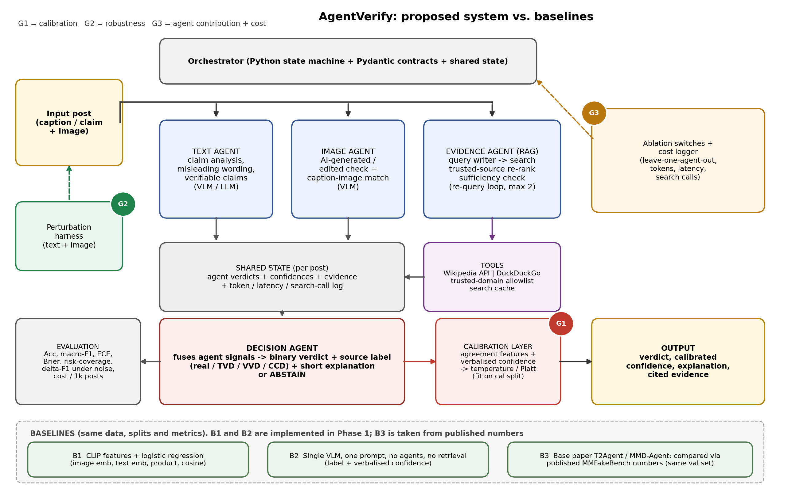

# AgentVerify (Phase 1: technical foundation and baselines)

Agentic multimodal fake news detection from text and images.
Course: Agentic AI. Project code / title / members: **fill in before submitting**.

Phase 1 delivers the data pipeline, shared contracts, model provider layer, evidence-tool
interface, perturbation utilities, evaluation code (accuracy, macro-F1, ECE, Brier, risk-coverage,
cost) and two non-agentic baselines. The agents themselves (text, image, evidence, decision) come in Phase 2.



| Baseline | What it is |
|---|---|
| B1 | Frozen CLIP embeddings + logistic regression (trained on 2,000 posts) |
| B2 | One vision-language-model call per post, no tools, no agents |
| B3 | Base paper (T2Agent) / MMD-Agent, compared through published numbers on the same MMFakeBench val set |

## 1. Setup
```bash
python -m venv .venv && source .venv/bin/activate      # Windows: .venv\Scripts\activate
pip install -e ".[dev]"
pip install -e ".[clip]"        # only needed for B1 (torch + transformers)
cp .env.example .env            # then put your key in .env and export it
```
Any OpenAI-compatible endpoint works. For a free local run use Ollama and set
`OPENAI_BASE_URL=http://localhost:11434/v1`, `OPENAI_API_KEY=ollama`, `AV_MODEL=qwen2.5vl:7b`.

## 2. Get the data (MMFakeBench, gated)
1. Open https://huggingface.co/datasets/liuxuannan/MMFakeBench, log in, accept the usage terms.
2. Download and unzip so you have `data/raw/MMFakeBench/MMFakeBench_val/` and `.../MMFakeBench_test/`.
3. **Never commit the data** (licence forbids redistribution; `data/raw/` is git-ignored).
```bash
python scripts/inspect_dataset.py --root data/raw/MMFakeBench   # check labels + images exist
python scripts/make_splits.py   --root data/raw/MMFakeBench     # writes id lists to data/splits/
```
If `inspect_dataset.py` reports an unknown `fake_cls` string, extend `normalize_source()` in
`src/agentverify/data/mmfakebench.py`.

## 3. Verify the install (no key, no data needed)
```bash
pytest -q
python scripts/smoke_test.py
```
Smoke-test numbers use a mock model and are **not** results.

## 4. Run the baselines
```bash
python scripts/run_b2_single_vlm.py --root data/raw/MMFakeBench --split val --limit 50  --out results/b2_val50.jsonl   # cheap trial
python scripts/run_b2_single_vlm.py --root data/raw/MMFakeBench --split val             --out results/b2_val.jsonl
python scripts/run_b1_clip.py       --root data/raw/MMFakeBench --out results/b1_val.jsonl
```
Each run writes `*.jsonl` (one RunRecord per post), `*_metrics.json` and `*_reliability.png`.
Parse failures are counted as wrong and reported as `parse_fail_rate`.

## 5. Layout
```
src/agentverify/
  contracts.py      Pydantic state: PostInput, AgentVerdict, EvidenceItem, FinalVerdict, CostLog, RunRecord
  llm.py            OpenAI-compatible client + offline MockClient
  prompts.py        B2 prompt
  data/             MMFakeBench loader, fixed splits, synthetic test data
  baselines/        clip_lr.py (B1), single_vlm.py (B2)
  tools/search.py   Wikipedia + DuckDuckGo evidence tool, trusted-domain rerank, disk cache
  perturb.py        label-preserving image/text perturbations (Phase 2, Gap 2)
  eval/             metrics.py (acc, F1, ECE, Brier, AURC, bootstrap CI), report.py
scripts/ tests/ docs/ results/
```

## 6. Status
- [x] pipeline, contracts, provider layer, evidence tool, perturbations, metrics, tests
- [x] B1, B2 implemented; offline smoke test passes
- [ ] initial B1/B2 numbers on MMFakeBench val (run section 4, paste into `results/RESULTS.md`)
- [ ] Phase 2: text/image/evidence/decision agents, calibration layer, robustness + ablation runs
